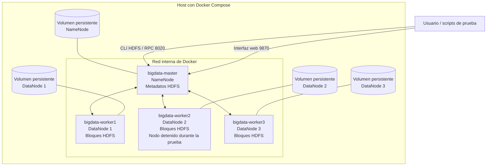

# Big Data – Grupo 01: tolerancia a fallos en HDFS

## 1. Descripción del proyecto

Este proyecto implementa un clúster distribuido de Hadoop HDFS mediante Docker Compose para estudiar el almacenamiento distribuido y la tolerancia a fallos. La arquitectura propuesta contiene un NameNode y tres DataNodes, con un factor de replicación configurado en 2.

La práctica consiste en crear dos archivos de prueba de **1 GiB** y **10 GiB**, almacenarlos en HDFS, registrar el estado inicial del clúster y detener el DataNode `bigdata-worker2`. Durante la falla se comprueba la disponibilidad de los archivos, la ubicación de los bloques, las réplicas disponibles y la posible recuperación automática de la replicación.

> **Importante:** las cifras definitivas de bloques, réplicas, tiempos de recuperación y resultados de lectura deben completarse con las salidas reales de los comandos. Este repositorio no presupone resultados que todavía no se hayan medido.

## 2. Objetivos

- Desplegar 1 NameNode y 3 DataNodes.
- Configurar un factor de replicación de 2.
- Generar y almacenar en HDFS datasets de 1 GiB y 10 GiB.
- Registrar la distribución de bloques antes y durante la caída de un DataNode.
- Verificar si los archivos siguen siendo legibles y si HDFS identifica bloques subreplicados.
- Observar si HDFS crea nuevas réplicas después del fallo.

## 3. Arquitectura



También se incluye el archivo editable [docs/arquitectura.mmd](docs/arquitectura.mmd) y una imagen SVG en [docs/arquitectura.svg](docs/arquitectura.svg).

### Componentes y puertos publicados

| Componente | Contenedor | Puerto del host | Función |
|---|---|---:|---|
| NameNode | `bigdata-master` | `9870` | Interfaz web de HDFS |
| NameNode RPC | `bigdata-master` | `8020` | Operaciones y metadatos de HDFS |
| DataNode 1 | `bigdata-worker1` | `9864` | Interfaz web del DataNode 1 |
| DataNode 2 | `bigdata-worker2` | `9865` → `9864` interno | Interfaz web del DataNode 2 |
| DataNode 3 | `bigdata-worker3` | `9866` → `9864` interno | Interfaz web del DataNode 3 |

La dirección web principal es [http://localhost:9870](http://localhost:9870). Los servicios se comunican entre sí mediante la red privada que crea Docker Compose.

## 4. Requisitos

- Docker Desktop con Docker Compose (o Docker Engine y el complemento `docker compose`).
- Git.
- Git Bash o WSL para ejecutar los scripts `.sh` en Windows; en Linux se pueden ejecutar desde Bash.
- Espacio libre suficiente en el disco usado por Docker. Para almacenar las dos cargas con replicación 2 y crear temporalmente el archivo de 10 GiB, es prudente disponer de al menos **35 GiB libres**.
- Conexión a Internet la primera vez para descargar las imágenes.

Las imágenes de contenedor se fijan en `bde2020/hadoop-*-2.0.0-hadoop3.2.1-java8`. Es una distribución comunitaria antigua seleccionada para una práctica reproducible; si el curso ya proporciona otras imágenes, hay que mantener la versión que usa el entorno del grupo y ajustar la configuración antes de reemplazarla.

## 5. Archivos del repositorio

```text
bigdata-grupo01/
├── README.md
├── docker-compose.yml
├── hadoop.env
├── .gitignore
├── scripts/
│   ├── 00_iniciar_clúster.sh
│   ├── 01_preparar_hdfs.sh
│   ├── 02_crear_datasets.sh
│   ├── 03_estado_inicial.sh
│   ├── 04_prueba_fallo.sh
│   └── 05_restaurar.sh
├── docs/
│   ├── arquitectura.mmd
│   ├── arquitectura.svg
│   └── RESULTADOS_TEMPLATE.md
├── resultados/
│   └── README.md
└── evidencias/
    └── README.md
```

- `docker-compose.yml`: define el NameNode, los tres DataNodes, los puertos y los volúmenes persistentes.
- `hadoop.env`: centraliza la configuración común de Hadoop, incluida la replicación.
- `scripts/`: contiene las operaciones de preparación, carga y prueba de fallo.
- `docs/`: guarda el diagrama y una plantilla para registrar los resultados.
- `resultados/`: guarda las salidas de comandos obtenidas durante la ejecución.
- `evidencias/`: guarda capturas de pantalla que demuestren la configuración y las pruebas.

No se necesita un `Dockerfile` propio en esta variante, porque `docker-compose.yml` utiliza imágenes Hadoop ya construidas. No conviene añadir un Dockerfile vacío o que no participe en el despliegue.

## 6. Instalación y ejecución

Ejecutar los comandos desde la raíz del repositorio.

### 6.1. Iniciar el clúster

```bash
docker compose config
docker compose up -d
docker compose ps
```

Esperar a que los cuatro contenedores estén activos y revisar el panel de HDFS en [http://localhost:9870](http://localhost:9870). También se puede comprobar el estado de los nodos con:

```bash
docker exec bigdata-master bash -lc "hdfs dfsadmin -report"
```

### 6.2. Preparar directorios HDFS

```bash
bash scripts/01_preparar_hdfs.sh
```

Se crean `/grupo01/dataset_1GB`, `/grupo01/dataset_10GB`, `/grupo01/resultados` y `/grupo01/evidencias`.

### 6.3. Crear y cargar los datasets

```bash
bash scripts/02_crear_datasets.sh
```

El script genera los archivos con `dd`, los carga en HDFS, solicita dos réplicas y elimina las copias temporales del contenedor maestro. Los nombres finales son:

- `/grupo01/dataset_1GB/dataset_grupo01_1GB`
- `/grupo01/dataset_10GB/dataset_grupo01_10GB`

La generación del archivo de 10 GiB y su replicación pueden tardar según los recursos disponibles.

### 6.4. Registrar el estado inicial

```bash
bash scripts/03_estado_inicial.sh
```

Los informes se guardan en `resultados/` con una marca de tiempo. Revisar tanto `hdfs dfsadmin -report` como `hdfs fsck` para comprobar el estado real.

### 6.5. Probar la caída del DataNode 2

Ejecutar las pruebas por separado para cada dataset. La prueba deja detenido `bigdata-worker2` intencionalmente para que las evidencias representen el estado durante la falla.

```bash
bash scripts/04_prueba_fallo.sh 1GB
bash scripts/05_restaurar.sh
```

Después de que el nodo vuelva a estar activo y el clúster se estabilice, repetir con el dataset de 10 GiB:

```bash
bash scripts/04_prueba_fallo.sh 10GB
bash scripts/05_restaurar.sh
```

Los scripts guardan el reporte de nodos, el resultado de `hdfs fsck` y una prueba de lectura (`LECTURA_OK` o `LECTURA_ERROR`). La detección de la caída y la reconstrucción de réplicas no son necesariamente instantáneas. Revisar las salidas guardadas y repetir `hdfs fsck` si el estado aún indica bloques subreplicados.

Comandos manuales equivalentes:

```bash
docker stop bigdata-worker2
docker exec bigdata-master bash -lc "hdfs dfsadmin -report"
docker exec bigdata-master bash -lc "hdfs fsck /grupo01/dataset_1GB/dataset_grupo01_1GB -files -blocks -locations"
docker exec bigdata-master bash -lc "hdfs dfs -cat /grupo01/dataset_1GB/dataset_grupo01_1GB > /dev/null && echo LECTURA_OK"
docker start bigdata-worker2
```

## 7. Resultados y evidencias

Completar [docs/RESULTADOS_TEMPLATE.md](docs/RESULTADOS_TEMPLATE.md) con los datos obtenidos realmente. No copiar como resultado real los números de ejemplo de la teoría. En particular, verificar:

- DataNodes activos antes y durante la falla.
- Número de bloques y ubicación de sus réplicas.
- Si todos los bloques conservan al menos una réplica accesible.
- Si la lectura completa devuelve `LECTURA_OK`.
- Si HDFS indica bloques subreplicados y si recupera el factor de replicación 2.
- Tiempo medido de detección y recuperación, si se mide.

En `evidencias/` añadir capturas con el número del grupo visible en el título o en la terminal. Se recomiendan: panel de NameNode con los tres DataNodes activos, salida inicial de `dfsadmin -report`, `fsck` antes de la falla, contenedor detenido, `fsck` durante la falla y lectura del archivo, y estado después de restaurar las réplicas.

## 8. Comandos útiles

```bash
# Estado de contenedores
docker compose ps

# Logs del NameNode
docker compose logs -f bigdata-master

# Estado de HDFS
docker exec bigdata-master bash -lc "hdfs dfsadmin -report"

# Revisar directorios de HDFS
docker exec bigdata-master bash -lc "hdfs dfs -ls -h /grupo01"

# Detener el entorno sin borrar volúmenes
docker compose down

# BORRA los datos persistidos del clúster; usar solo si se desea reiniciar desde cero
# docker compose down -v
```

## 9. Publicación en GitHub y commits

Crear en GitHub un repositorio **público** llamado `bigdata-grupo01`, sin generar un README adicional si ya se va a subir este archivo. Luego, desde la carpeta local del proyecto, ejecutar:

```bash
git init
git branch -M main

git add README.md docs
git commit -m "docs: documentar objetivo y arquitectura de HDFS"

git add docker-compose.yml hadoop.env .gitignore
git commit -m "feat: configurar clúster HDFS con tres DataNodes"

git add scripts resultados evidencias
git commit -m "test: automatizar datasets y pruebas de tolerancia a fallos"
```

Después de crear el repositorio en GitHub, conectar la URL real y publicar:

```bash
git remote add origin https://github.com/USUARIO_GITHUB/bigdata-grupo01.git
git push -u origin main
```

Sustituir `USUARIO_GITHUB` por el usuario real. Los tres commits anteriores dejan evidencia de avances diferenciados. Una vez realizadas las pruebas, agregar también los resultados y capturas reales con un cuarto commit:

```bash
git add README.md resultados evidencias docs/RESULTADOS_TEMPLATE.md
git commit -m "docs: agregar resultados y evidencias experimentales"
git push
```

## 10. Alcance y limitaciones

Este repositorio proporciona una plantilla ejecutable de la práctica descrita para el Grupo 01. Los resultados experimentales dependen de la ejecución real en el equipo del grupo y deben registrarse antes de entregar. El repositorio no debe contener los archivos binarios de 1 GiB y 10 GiB: los scripts los generan en tiempo de ejecución dentro del contenedor.
