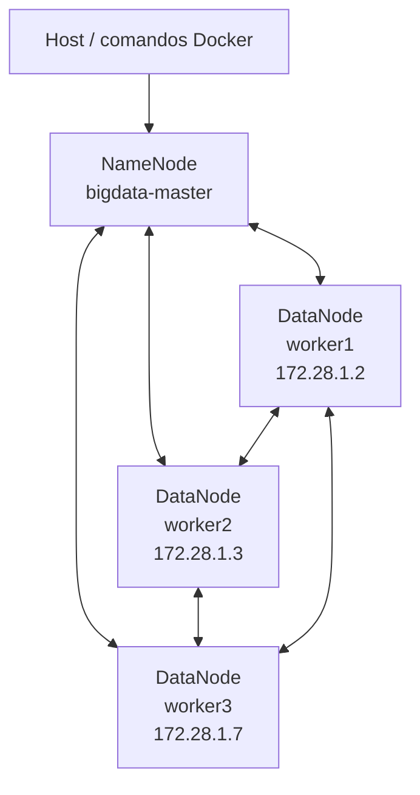

# Tolerancia a fallos en HDFS — Grupo 01

Práctica de Big Data para analizar la tolerancia a fallos de **Hadoop Distributed File System (HDFS)** cuando se detiene un DataNode. Se utilizan dos datasets de **1 GiB y 10 GiB**, un clúster con un NameNode y tres DataNodes, y un factor de replicación de 2.

> **Estado de la práctica:** se verificó que los archivos permanecen disponibles durante la caída de `bigdata-worker2`. Queda pendiente esperar a que el NameNode declare muerto el DataNode y registrar la recuperación automática de las réplicas.

## Objetivo

Implementar y probar un entorno HDFS distribuido para observar:

- La distribución de los bloques y sus réplicas entre los DataNodes.
- El estado del clúster antes y después de detener un DataNode.
- La disponibilidad de los archivos durante la falla.
- El comportamiento de HDFS cuando el NameNode detecta la pérdida de un DataNode y necesita restaurar el factor de replicación.

## Arquitectura

El entorno utiliza un nodo maestro y tres nodos de almacenamiento. Los servicios se ejecutan en contenedores Docker y se comunican dentro de la red del proyecto.



### Componentes y configuración

| Elemento | Configuración utilizada |
|---|---|
| NameNode | 1 contenedor: `bigdata-master` |
| DataNodes | 3 nodos: `worker1`, `worker2` y `worker3` |
| IP de `worker1` | `172.28.1.2` |
| IP de `worker2` | `172.28.1.3` |
| IP de `worker3` | `172.28.1.7` |
| Factor de replicación | 2 |
| Tamaño de bloque | 134217728 bytes (128 MiB) |
| Dataset pequeño | 1 GiB (1073741824 bytes) |
| Dataset grande | 10 GiB (10737418240 bytes) |
| Falla simulada | Detención del contenedor `bigdata-worker2` |

## Requisitos

- Docker instalado y en ejecución.
- Docker Compose disponible.
- La configuración del clúster Hadoop del proyecto, incluido el servicio `bigdata-master` y los DataNodes indicados en este documento.
- Espacio suficiente para generar y almacenar los datasets de 1 GiB y 10 GiB, además de sus réplicas.

## Instalación y ejecución

Los pasos siguientes presuponen que el repositorio contiene el archivo `docker-compose.yml` con los servicios del clúster y que sus nombres coinciden con los documentados aquí.

### 1. Iniciar el clúster

Desde el directorio del repositorio:

```bash
docker compose up -d
```

Comprobar que los contenedores estén en ejecución:

```bash
docker ps
```

### 2. Verificar DataNodes y configuración HDFS

Consultar el estado del clúster:

```bash
docker exec bigdata-master bash -c "hdfs dfsadmin -report"
```

Consultar el factor de replicación y el tamaño de bloque configurados:

```bash
docker exec bigdata-master bash -c "hdfs getconf -confKey dfs.replication"
docker exec bigdata-master bash -c "hdfs getconf -confKey dfs.blocksize"
```

En la práctica se utilizaron un factor de replicación de `2` y bloques de `134217728` bytes.

## Procedimiento experimental

Todos los comandos HDFS de esta sección se ejecutan desde el host mediante `docker exec` sobre `bigdata-master`.

### 1. Crear los directorios del Grupo 01

```bash
docker exec bigdata-master bash -c "hdfs dfs -mkdir -p /grupo01/dataset_1GB /grupo01/dataset_10GB /grupo01/resultados /grupo01/evidencias"
```

La estructura utilizada en HDFS es:

```text
/grupo01/
├── dataset_1GB/
├── dataset_10GB/
├── resultados/
└── evidencias/
```

### 2. Generar y cargar el dataset de 1 GiB

El archivo se genera con ceros, se copia a HDFS, se verifica y se elimina la copia temporal local del contenedor maestro.

```bash
docker exec bigdata-master bash -c "dd if=/dev/zero of=/tmp/dataset_grupo01_1GB bs=1M count=1024 status=progress"
docker exec bigdata-master bash -c "hdfs dfs -put -f /tmp/dataset_grupo01_1GB /grupo01/dataset_1GB/dataset_grupo01_1GB"
docker exec bigdata-master bash -c "hdfs dfs -ls -h /grupo01/dataset_1GB"
docker exec bigdata-master bash -c "rm -f /tmp/dataset_grupo01_1GB"
```

### 3. Generar y cargar el dataset de 10 GiB

```bash
docker exec bigdata-master bash -c "dd if=/dev/zero of=/tmp/dataset_grupo01_10GB bs=1M count=10240 status=progress"
docker exec bigdata-master bash -c "hdfs dfs -put -f /tmp/dataset_grupo01_10GB /grupo01/dataset_10GB/dataset_grupo01_10GB"
docker exec bigdata-master bash -c "hdfs dfs -ls -h /grupo01/dataset_10GB"
docker exec bigdata-master bash -c "rm -f /tmp/dataset_grupo01_10GB"
```

### 4. Registrar el estado inicial

```bash
docker exec bigdata-master bash -c "hdfs dfsadmin -report"
docker exec bigdata-master bash -c "hdfs fsck /grupo01/dataset_1GB/dataset_grupo01_1GB -files -blocks -locations"
docker exec bigdata-master bash -c "hdfs fsck /grupo01/dataset_10GB/dataset_grupo01_10GB -files -blocks -locations"
```

Antes de provocar la falla, se registraron tres DataNodes activos. El archivo de 1 GiB tiene 8 bloques y el de 10 GiB tiene 80 bloques; en ambos casos, el factor de replicación configurado es 2.

### 5. Simular la caída de un DataNode

Detener únicamente el contenedor correspondiente a `worker2`:

```bash
docker stop bigdata-worker2
```

Después, repetir los siguientes comandos para documentar el estado durante la falla:

```bash
docker exec bigdata-master bash -c "hdfs dfsadmin -report"
docker exec bigdata-master bash -c "hdfs fsck /grupo01/dataset_1GB/dataset_grupo01_1GB -files -blocks -locations"
docker exec bigdata-master bash -c "hdfs fsck /grupo01/dataset_10GB/dataset_grupo01_10GB -files -blocks -locations"
```

### 6. Comprobar que el dataset de 1 GiB sigue siendo legible

El contenido se redirige a `/dev/null` para no imprimir el archivo en la terminal:

```bash
docker exec bigdata-master bash -c "hdfs dfs -cat /grupo01/dataset_1GB/dataset_grupo01_1GB > /dev/null && echo LECTURA_OK"
```

El resultado observado fue `LECTURA_OK`. Durante la lectura, el cliente no pudo conectarse a `worker2`, lo descartó y leyó una réplica disponible en `worker3`.

### 7. Verificar la detección de la falla y la recuperación

El NameNode necesita detectar que el DataNode dejó de enviar latidos (*heartbeats*). En esta ejecución, aproximadamente ocho minutos después de detener `worker2`, el nodo todavía aparecía como activo en el reporte porque aún no se había cumplido el tiempo de espera observado/documentado en la práctica (aproximadamente 10 minutos y 30 segundos).

Para completar esta parte, esperar a que venza el tiempo de detección y volver a ejecutar:

```bash
docker exec bigdata-master bash -c "hdfs dfsadmin -report"
docker exec bigdata-master bash -c "hdfs fsck /grupo01/dataset_1GB/dataset_grupo01_1GB -files -blocks -locations"
docker exec bigdata-master bash -c "hdfs fsck /grupo01/dataset_10GB/dataset_grupo01_10GB -files -blocks -locations"
```

Registrar con las nuevas salidas cuántos DataNodes reconoce el NameNode, cuántos bloques aparecen subreplicados, cuándo se crean nuevas réplicas y cuánto tarda la recuperación. **Estos valores quedan pendientes de medición y no se presentan como resultados confirmados en este README.**

## Resultados obtenidos

| Comprobación | Dataset de 1 GiB | Dataset de 10 GiB |
|---|---|---|
| Tamaño | 1073741824 bytes | 10737418240 bytes |
| Bloques | 8 | 80 |
| Tamaño de bloque | 128 MiB | 128 MiB |
| Factor de replicación | 2 | 2 |
| DataNode detenido | `worker2` (`172.28.1.3`) | `worker2` (`172.28.1.3`) |
| Estado observado en `fsck` durante la prueba | `HEALTHY`, 8 de 8 bloques con 2 réplicas | `HEALTHY`, 80 bloques y 0 subreplicados según la salida registrada |
| Lectura completa durante la falla | Confirmada: `LECTURA_OK` | No registrada en la evidencia disponible |
| Bloques con réplica en `worker2` identificados | 2 de 8: bloques 0 y 4 | No se contabilizaron todos; la evidencia disponible muestra los bloques 60–79 |
| Tiempo de recuperación y nuevas réplicas | Pendiente de medir | Pendiente de medir |

### Interpretación

- **La replicación permite mantener la disponibilidad:** el dataset de 1 GiB siguió siendo legible porque existían otras réplicas de los bloques.
- **La detección de la caída no es instantánea:** detener el contenedor no significa que el NameNode lo declare muerto inmediatamente; durante el intervalo de espera puede seguir apareciendo como activo.
- **La disponibilidad y la replicación son diferentes:** un archivo puede seguir siendo legible mientras algún bloque tiene menos réplicas accesibles de las configuradas.
- **El dataset de mayor tamaño facilita observar más bloques:** en esta práctica, el archivo de 10 GiB tiene 80 bloques frente a los 8 del archivo de 1 GiB. La duración real de la recuperación debe medirse, no suponerse solo por el tamaño.

## Evidencias que se deben conservar

Guardar capturas o salidas de terminal, identificadas como Grupo 01, para documentar:

1. Creación de directorios y carga de los dos datasets.
2. `hdfs dfsadmin -report` antes de detener el DataNode.
3. `hdfs fsck` de ambos archivos antes de la falla, con bloques y ubicaciones.
4. Detención del contenedor `bigdata-worker2`.
5. Reporte y `fsck` durante la falla.
6. Resultado `LECTURA_OK` de la lectura del dataset de 1 GiB.
7. Reporte y `fsck` después de que el NameNode detecte la caída, incluyendo subreplicación y creación de nuevas réplicas.
8. Medición del tiempo de recuperación, una vez completada esa etapa.

Las rutas `/grupo01/resultados/` y `/grupo01/evidencias/` están creadas en HDFS para organizar la práctica. Las capturas o archivos guardados en el equipo local deben agregarse al repositorio si se requiere entregarlos junto con el README.

## Recuperar el entorno

Al terminar las pruebas, volver a iniciar el contenedor detenido:

```bash
docker start bigdata-worker2
```

Comprobar el estado del clúster y la distribución de bloques:

```bash
docker exec bigdata-master bash -c "hdfs dfsadmin -report"
docker exec bigdata-master bash -c "hdfs fsck /grupo01/dataset_1GB/dataset_grupo01_1GB -files -blocks -locations"
docker exec bigdata-master bash -c "hdfs fsck /grupo01/dataset_10GB/dataset_grupo01_10GB -files -blocks -locations"
```

## Estructura sugerida del repositorio

```text
bigdata-grupo01/
├── README.md
├── docker-compose.yml
├── Dockerfile                 # si el proyecto utiliza uno
├── scripts/                   # scripts de automatización, si corresponde
└── evidencias/
    ├── 01-directorios.png
    ├── 02-dataset-1GB.png
    ├── 03-dataset-10GB.png
    ├── 04-estado-inicial.png
    ├── 05-falla-worker2.png
    ├── 06-lectura-durante-falla.png
    └── 07-recuperacion-hdfs.png  # pendiente de completar
```

La estructura es una propuesta para organizar la entrega. Mantener `docker-compose.yml`, Dockerfiles y scripts reales del proyecto; no agregar archivos vacíos ni evidencias que todavía no se hayan generado.

## Conclusiones

La prueba demuestra que HDFS puede mantener disponible un archivo ante la caída de un DataNode cuando existen réplicas en otros nodos. En el dataset de 1 GiB, el cliente descartó el nodo que no respondía y completó la lectura desde otra réplica. Sin embargo, la restauración del factor de replicación debe verificarse después de que el NameNode detecte formalmente la falla. La medición de los bloques subreplicados, las nuevas réplicas y el tiempo de recuperación de ambos datasets queda pendiente para cerrar esa parte del experimento.

## Grupo

**Grupo 01** — Práctica de Big Data: tolerancia a fallos en HDFS con datasets de 1 GiB y 10 GiB.
